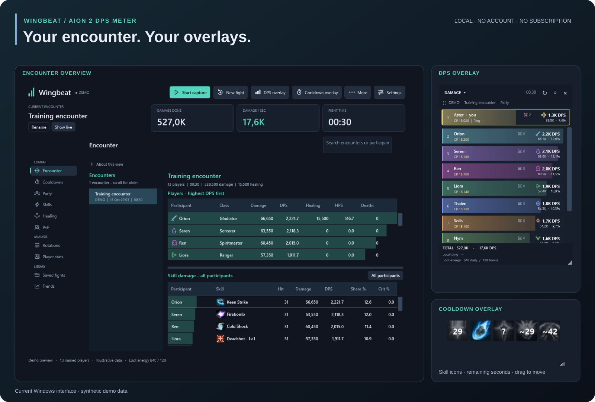
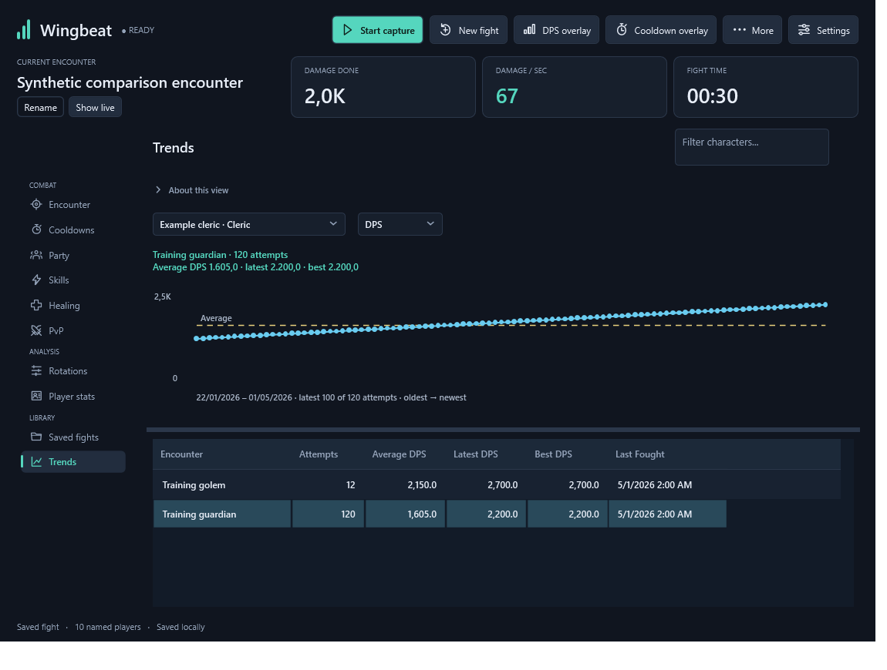
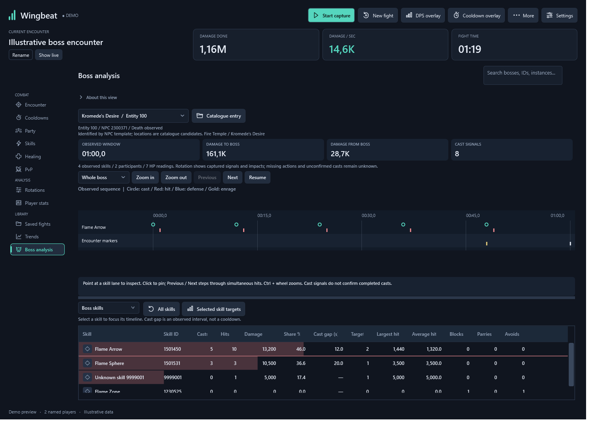
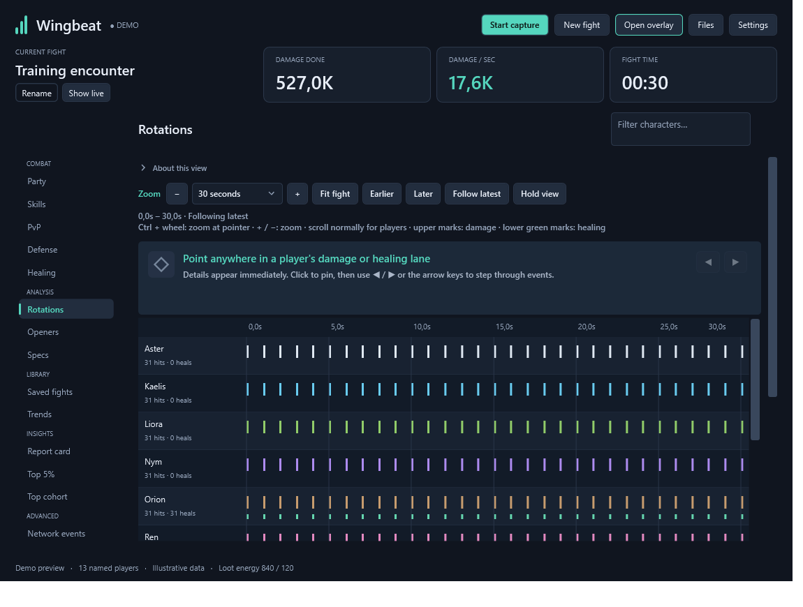
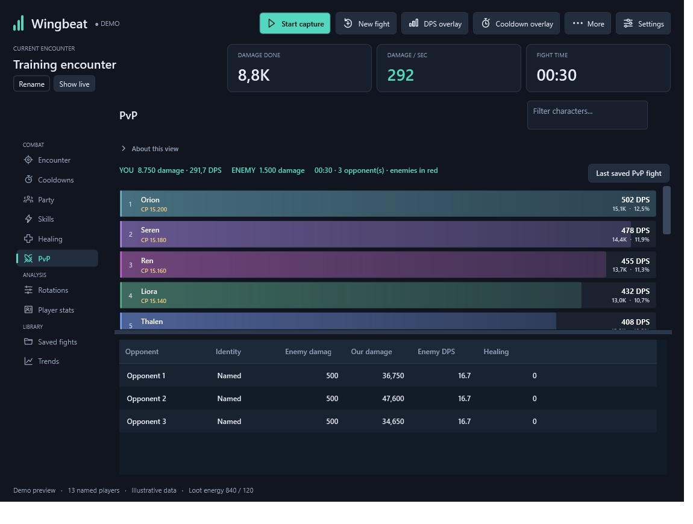
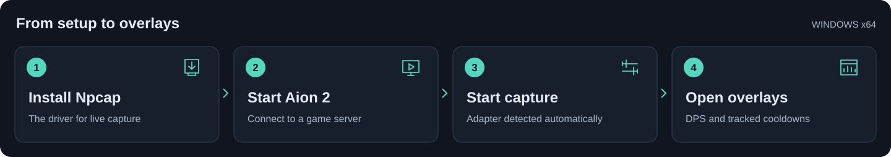

Wingbeat ♥ Aion 2 DPS Meter
============================

**Built for privacy: zero outbound requests.**

No logins, automatic update checks, runtime downloads, or telemetry.
Your combat data stays on your PC.

Free Aion 2 DPS meter for Windows. No account or subscription.

Local by design
---------------

A packet-capture tool should earn your trust. Wingbeat processes captured traffic
on your PC, calculates your combat statistics locally, and keeps settings,
player profiles and encounter history in local files.

* **No live API calls or phone-home requests.** The meter does not send captured
  traffic or combat statistics to an external service.
* **No cloud dependency.** Skill names, icons and NPC data are bundled, so the
  meter needs no external service to analyse your fights. Aion still needs its
  own game connection.
* **Passive capture.** Wingbeat reads packets through Npcap; it does not inject
  packets or modify the game's memory.
* **Source you can inspect.** Review the capture, decoding and storage code here,
  or build the application yourself.

Features
--------

* Live DPS and healing meters, parties of up to 10 players, and multiple PvP opponents.
* Damage and healing breakdowns by player, skill and target, with contribution bars.
* Transparent, movable overlays with class icons, class colours, themes and death counts.
* A separate cooldown overlay with skill icons and countdowns, including charge variants.
* Zoomable party rotations and boss analysis with captured skills, damage and HP.
* Saved encounters and DPS/HPS trends: average, latest and best performance per encounter.
* CP, cached player classes, local ping, loot energy and captured player stats.
* Bundled skill names, icons, NPC names and a searchable boss catalogue.
* Automatic adapter detection, optional startup capture and saved overlay positions.

Live decoding is experimental; readings depend on supported packets being captured.

.. list-table::
   :widths: 50 50

   * - |trends|
     - |boss|
   * - |rotations|
     - |pvp|

Synthetic demo data. More previews: `Skills <docs/images/skills.png>`_,
`Healing <docs/images/healing.png>`_ and `Party <docs/images/party-meter.png>`_.

Setup
-----

1. Download the **Windows x64 ZIP** from Releases and extract it.
2. Install `Npcap <https://npcap.com/#download>`_ for live capture.
   Wingbeat also offers this link if Npcap is missing.
3. Run ``Wingbeat.exe``. The release includes the .NET runtime.
4. Open Aion 2, connect to a server, then click **Start capture**.
   Wingbeat detects the game adapter; use **Settings > Capture** to select it manually if needed.
5. Change zones while capture is running to receive your character identity and CP.
6. Click **DPS overlay** to show the meter. Its menu switches between damage and healing.
7. Open **Cooldowns**, choose your skills, then click **Cooldown overlay**.
   Configure a cooldown duration if the game does not report one.

Drag the DPS overlay header or cooldown icons to move them. Resize from the corner.
The toolbar overlay buttons toggle visibility; positions are saved automatically.

**Settings > Startup** controls automatic capture and overlay restoration.
Resuming a configured setup is enabled by default.

Settings, cached profiles and saved fights stay in ``%LOCALAPPDATA%\Wingbeat``
and survive application updates. Use **More > Open data folder** to access them.

**Build from source:** install the .NET 10 SDK on Windows, then run from the repository root::

    powershell -File .\Build-Windows.ps1

The standalone ZIP is written to ``releases/``. Npcap is installed separately.

`Third-party notices <THIRD-PARTY-NOTICES.txt>`_ · `Third-party licenses <licenses/>`_
