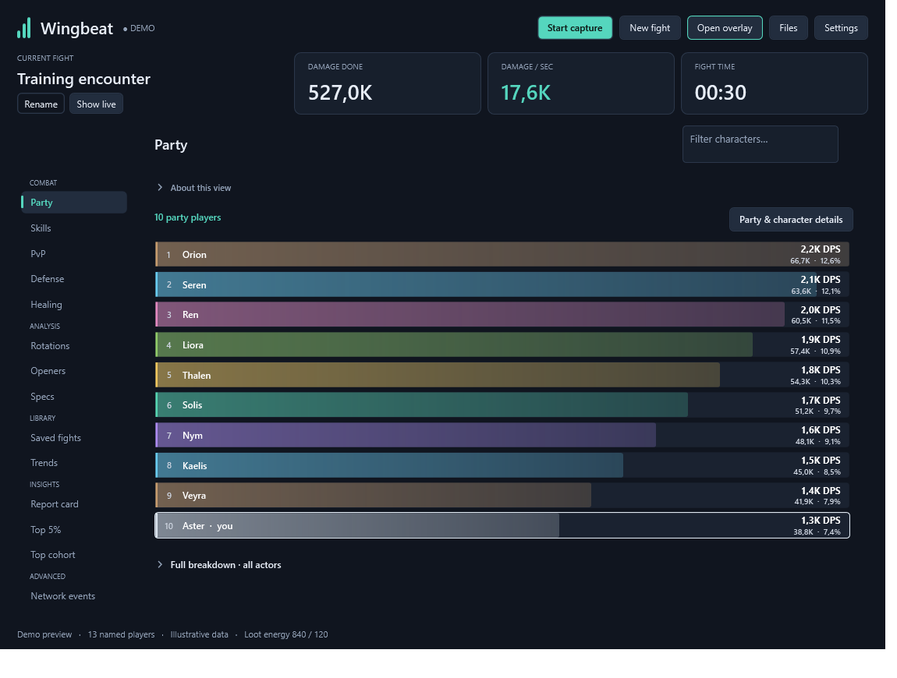
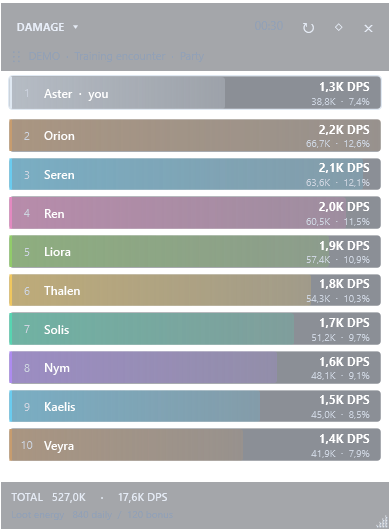

Wingbeat ♥ Aion 2 DPS Meter
==========================

Free local Aion 2 DPS meter for Windows with live damage, healing, PvP tracking,
and a customizable overlay. No external account or login is required.

Repository name: ``wingbeat-aion-dps-meter``.

Demo screenshots
----------------

These are real app screenshots using built-in synthetic demo data. Names,
numbers and encounters are illustrative, not recordings of real players.

   Party damage breakdown with DPS, contribution and encounter duration.

   Transparent damage overlay with your character pinned first and loot energy below.

.. figure:: docs/images/party-rotations.png
   :alt: Wingbeat rotation view with separate damage and healing lanes and timeline zoom controls.
   :width: 100%

   Party rotation timelines with zoom controls and damage and healing events.

.. figure:: docs/images/pvp-tracking.png
   :alt: Wingbeat PvP view showing three demo opponents and incoming and outgoing damage.
   :width: 100%

   PvP tracking with multiple opponents and damage in both directions.

Build and run
-------------

Build with the .NET 10 SDK using ``powershell -File .\Build-Windows.ps1``.
The resulting Windows x64 package includes the .NET runtime. Run ``Wingbeat.exe``;
live capture additionally requires the separately installed Npcap driver.
Game decoding and healing support remain experimental and partial.

The project is being prepared for open-source release; its own license has not
yet been selected. Dependency terms are in ``THIRD-PARTY-NOTICES.txt`` and
``licenses/``. Local fight history, captures, settings and private notes are
excluded from Git. Run ``powershell -File .\Verify-Public.ps1`` after staging
changes and review the staged diff before publishing.
