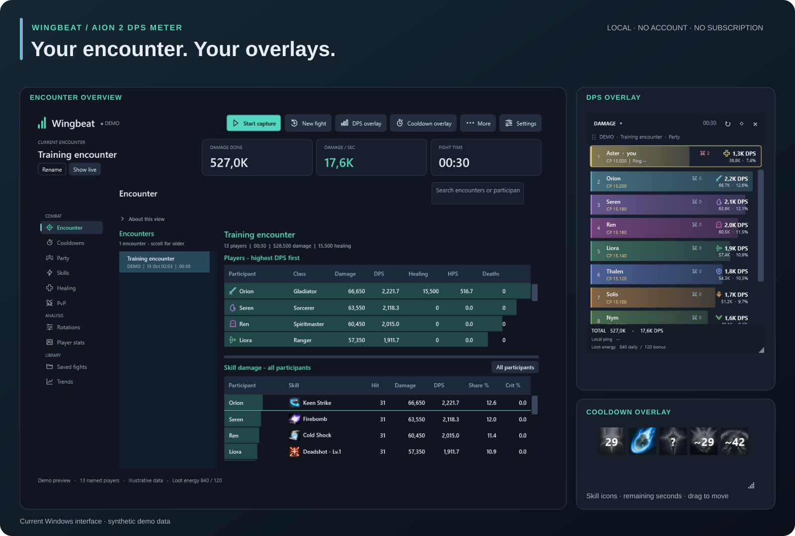
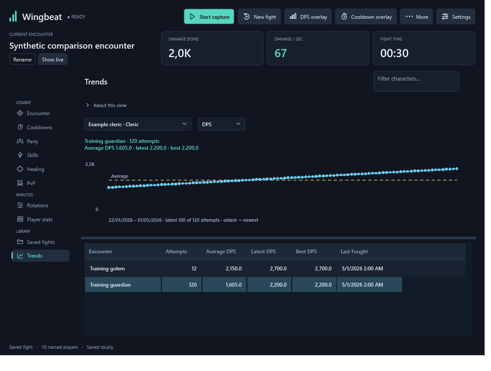
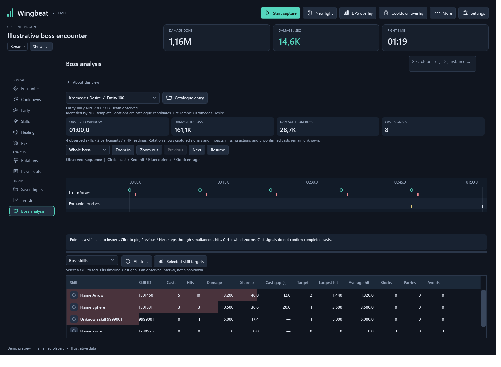
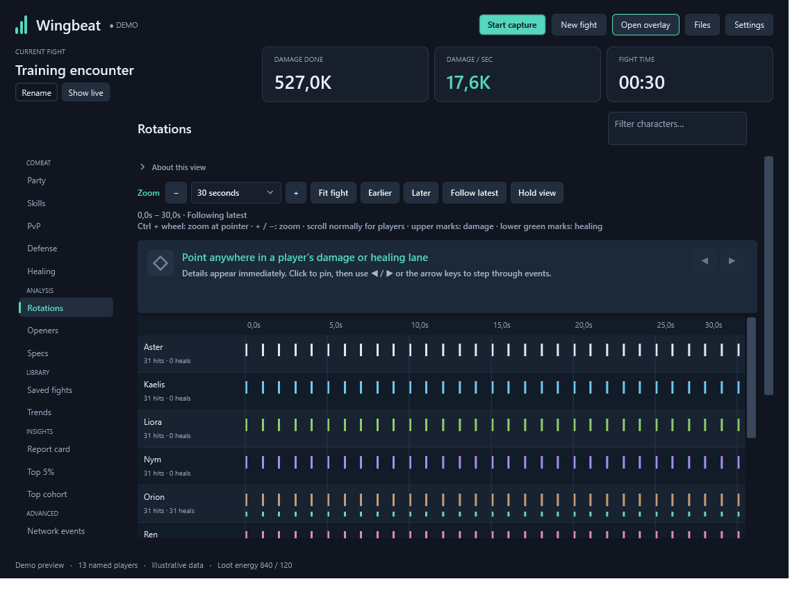
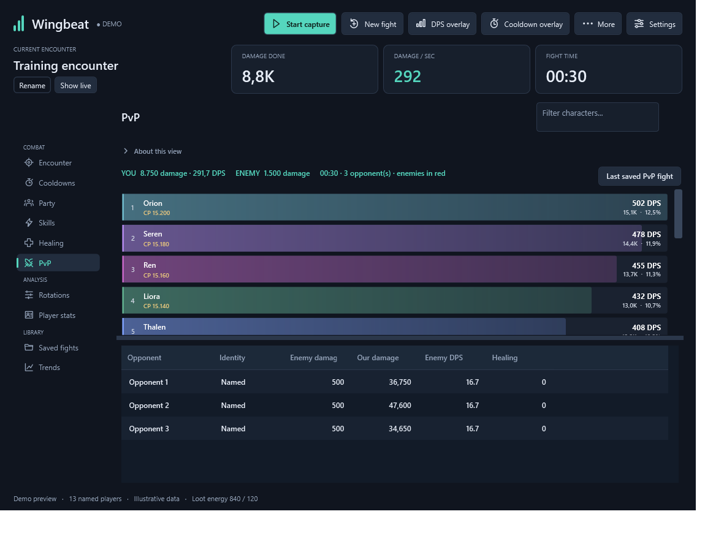
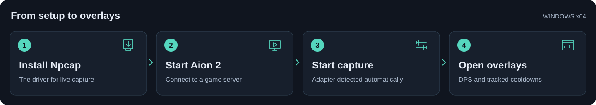

Wingbeat ♥ Aion 2 DPS Meter
============================

Wingbeat is a free AION 2 DPS meter for Windows with real-time damage and healing
tracking, skill cooldown overlays, and combat statistics.

**Combat data stays on your PC.**

No logins, combat uploads, automatic installation, or telemetry. Wingbeat checks
GitHub for newer releases on startup. An available update opens its download page
in your browser when you click it; downloading and installing remain manual.

No account or subscription.

Local by design
---------------

A packet-capture tool should earn your trust. Wingbeat processes captured traffic
on your PC, calculates your combat statistics locally, and keeps settings,
player profiles and encounter history in local files.

* **No combat uploads.** The meter does not send captured traffic or combat
  statistics to an external service. Its GitHub release check requests public
  release metadata and includes the installed application version.
* **No cloud dependency.** Skill names, icons and NPC data are bundled, so the
  meter needs no external service to analyse your fights. Aion still needs its
  own game connection.
* **Passive capture.** Wingbeat reads packets through Npcap; it does not inject
  packets or modify the game's memory.
* **Source you can inspect.** Review the capture, decoding and storage code here,
  or build the application yourself.

Features
--------

* Live DPS and healing meters, parties of up to 10 players, and multiple PvP opponents.
* Damage and healing breakdowns by player, skill and target, with contribution bars.
* Two independent, movable meters: **DPS1** and optional **DPS2**, each with its own
  mode, position and size. Show damage alongside party health or healing.
* Party-health bars with captured HP percentages and supported debuffs. Bars fade
  from green at 75% to yellow at 50%, then red at 25% and below.
* Transparent overlays with class icons, class colours, themes and death counts.
* Boss alerts for supported captured casts and mechanics, with smooth full-card
  countdowns. Alerts stay invisible while idle; placement preview is available in setup.
  HP-based preparation warnings cover selected bosses, not every encounter.
* A separate cooldown overlay with skill icons and countdowns, including charge variants.
  Its live cast row shows captured cast time and cancellation/interruption feedback;
  charges without a reported duration use an indeterminate bar.
* Zoomable party rotations and boss analysis with captured skills, damage and HP.
* Saved encounters and DPS/HPS trends: average, latest and best performance per encounter.
* CP, cached player classes, local ping, loot energy and captured player stats.
* Bundled skill names, icons, NPC names and a searchable boss catalogue.
* Automatic adapter detection, optional startup capture and saved overlay positions.
* Optional personal skill bars and player/target filters in the DPS overlay.
* Square, round and bar cooldown layouts, ready glow, captured timer reductions,
  optional combat-only visibility and live effect countdowns.
* Local timed training with notes, groups and per-skill attempt comparisons.
* PvP confirmed kills, peak five-second damage and per-opponent exchange timelines.
* Captured boss health, local personal-best notifications and copyable fight summaries.

Effects with unknown durations are marked explicitly. Source-skill icons are not
proof of an effect's name or type; stack counts and maximum HP are not inferred.
Personal bests compare the same character, server, class and exact boss NPC template
after a captured boss death. They describe your local records, not global rankings.

Live decoding is experimental; readings depend on supported packets being captured.
Party health shows the last captured HP, and missing values are labelled unknown.
Until a party roster is captured, the health meter can show observed combat players;
once the roster arrives, it uses confirmed party members. Debuffs require supported
effect packets and confirmed party identity.

.. list-table::
   :widths: 50 50

   * - |trends|
     - |boss|
   * - |rotations|
     - |pvp|

Synthetic demo data. More previews: `Skills <docs/images/skills.png>`_,
`Healing <docs/images/healing.png>`_ and `Party <docs/images/party-meter.png>`_.

Setup
-----

1. Download the **Windows x64 ZIP** from Releases and extract it.
2. Install `Npcap <https://npcap.com/#download>`_ for live capture.
   Wingbeat also offers this link if Npcap is missing.
3. Run ``Wingbeat.exe``. The release includes the .NET runtime.
4. Open Aion 2, connect to a server, then click **Start capture**.
   Wingbeat detects the game adapter; use **Settings > Capture** to select it manually if needed.
5. Change zones while capture is running to receive your character identity and CP.
6. Use the first-run placement setup to arrange your DPS meter and boss alerts.
   Click **DPS1 overlay** to show the primary meter; its menu switches between
   damage, healing and **Party health**. Enable **DPS2 overlay** for a second meter
   with independent settings, for example party health beside your DPS display.
7. Open **Cooldowns**, choose your skills, then click **Cooldown overlay**.
   Configure a cooldown duration if the game does not report one.

Drag the DPS overlay header or cooldown icons to move them. Resize from the corner.
The toolbar overlay buttons toggle visibility; positions are saved automatically.
Use **Boss alerts** in the header to enable mechanic warnings. To preview their
position while no alert is active, use the placement controls in Settings.

**Settings > Startup** controls automatic capture and overlay restoration.
Resuming a configured setup is enabled by default.

Settings, cached profiles and saved fights stay in ``%LOCALAPPDATA%\Wingbeat``
and survive application updates. Use **More > Open data folder** to access them.

**Build from source:** install the .NET 10 SDK on Windows, then run from the repository root::

    powershell -File .\Build-Windows.ps1

The standalone ZIP is written to ``releases/``. Npcap is installed separately.

`Third-party notices <THIRD-PARTY-NOTICES.txt>`_ · `Third-party licenses <licenses/>`_
