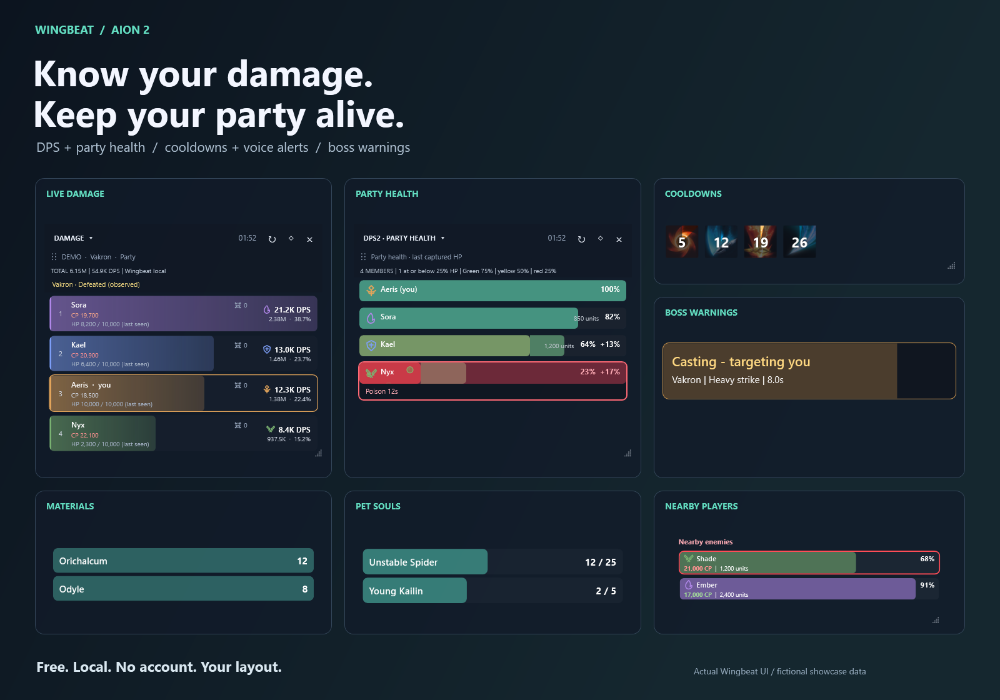
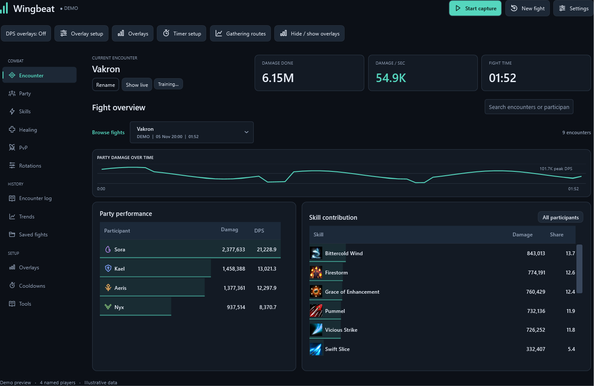
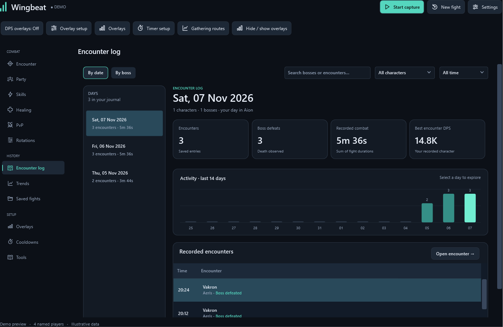

Wingbeat | Aion 2 DPS Meter
===========================

**Know your damage. Keep your party alive.**

Live DPS, healer-friendly party bars, cooldown voice alerts and boss warnings—in
movable overlays that fit around your game. Free, local, and no account required.

`Download for Windows <https://github.com/Klauensprung/Wingbeat-Aion-Dps-Meter/releases/latest/download/Klauensprung.Wingbeat-win-Setup.exe>`_
· `Portable ZIP & release notes <https://github.com/Klauensprung/Wingbeat-Aion-Dps-Meter/releases/latest>`_
· `Report a bug <https://github.com/Klauensprung/Wingbeat-Aion-Dps-Meter/issues>`_

Actual Wingbeat interface. Player names, fights and values in these screenshots are fictional showcase data.

Your fight, at a glance
-----------------------

* **DPS and party health, side by side.** Two independent meters let you keep damage,
  healing or party HP wherever you need it. Class icons, smooth bars and skill
  breakdowns make the important numbers easy to find.
* **A clearer view for healers.** See captured HP, regeneration previews and debuffs.
  Low health pulses red; debuffs add green bubbles without covering the missing-health
  area. Members known to be far away are grayed out and moved down the list.
* **Hear when your skills are ready.** Choose cooldowns and buff uptimes to track,
  pick square, round or bar layouts, and enable optional spoken skill-name alerts.
  Keep separate presets for your characters.
* **Keep an eye on the boss.** Supported casts and mechanics get visible warnings
  and smooth countdowns. Alerts disappear when there is nothing to show.
* **Build your own layout.** Overlay setup shows real previews with sample data.
  Drag, resize or scale, then enable only what you want. Hide overlays with a
  configurable hotkey or snooze an individual overlay for 60 seconds.

See what made the difference
----------------------------

Review an encounter's damage, healing and skills, or browse your local encounter
log by date or boss. Compare attempts without uploading your fights.

More than a meter
-----------------

**For the Abyss:** an optional nearby-enemy overlay shows identified players,
classes, CP comparisons, available health and captured distance. Your current target
moves to the top. A first captured PvP hit on another party member can trigger
**“Playername gets attacked!”**, without repeating on every hit.

**For gathering:** select two materials and follow separate gold and red routes.
Routes start near your captured position and refresh after teleports. Small,
transparent counters track collected materials and pet souls.

**For exploration:** optional flight-power and hidden-cube overlays. Cube routes
show possible locations; the live compass only points to supported cube types
actually detected in captured traffic.

Start in a few minutes
----------------------

1. Download and run **Klauensprung.Wingbeat-win-Setup.exe**. Wingbeat installs for
   your Windows user and appears in the Start menu. The .NET runtime is included.
2. Install `Npcap <https://npcap.com/#download>`_ for live capture if it is not
   already installed. Wingbeat provides the download link when it is missing.
3. Open Aion 2, connect to a server, and click **Start capture**. Adapter detection
   is automatic; manual selection is available in **Settings > Capture**.
4. Open **Overlay setup** at the top. Position the previews and choose **Enable**
   or **Skip**. Use **DPS overlays: On/Off** to toggle your selected meters together.
5. Select your skills in **Cooldowns**. Use **Timer setup** for notifications and
   **Gathering routes** to choose materials.

If character details are missing, change zones while capture is running so Wingbeat
can receive the identity packets. **Settings > Startup** controls capture and
layout restoration on the next launch.

Installed versions with updating support can download new releases through
Wingbeat's GitHub updater and restart when ready. Portable builds open the GitHub
download page instead. Settings and cached data stay in
``%LOCALAPPDATA%\Wingbeat`` across updates.

Local by design
---------------

No account, subscription or combat uploads. Captured traffic, encounter history
and player profiles are processed and stored on your PC. Wingbeat passively reads
traffic through Npcap; it does not inject packets or modify game memory.

Skill names, icons and reference data are bundled. GitHub is used for release
checks and requested updates. Interface and game-name language settings are separate,
with English and German support.

What the meter can see
----------------------

Readings depend on the supported packets Wingbeat captures. Party health is the
last captured value; unknown values stay unknown. Range is a position-based estimate,
not a guarantee of healing range or line of sight. Regeneration is a reported
remaining amount, not a promise of future healing.

Boss warnings cover supported casts and selected mechanics, not every boss phase.
Gathering routes suggest straight-line stops, not paths around terrain. Hidden-cube
locations are possible spawns; live detection currently covers two verified cube
templates. PvP attack warnings require an identified player and a confirmed party
member, and begin on the first captured damaging hit.

Build it yourself
-----------------

On Windows with the .NET 10 SDK, run from the repository root::

    powershell -File .\Build-Windows.ps1

Rebuild the public screenshot set from its synthetic fixture::

    dotnet build .\AionDpsMeter\AionDpsMeter.csproj -c Release
    .\AionDpsMeter\bin\Release\net10.0-windows\Wingbeat.exe --export-readme

Images are written to ``readme-showcase`` beside that executable. The exporter
uses isolated test settings and ``examples/overlay-showcase.json``; it does not
read your saved encounters or capture network traffic.

`Third-party notices <THIRD-PARTY-NOTICES.txt>`_ · `Licenses <licenses/>`_
